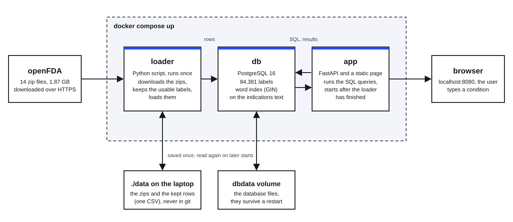

# Which drugs treat this condition?

Type a condition, for example "migraine", and the page lists the active ingredients whose FDA label names it under "Indications and usage", in how many labels, prescription (Rx) or over the counter (OTC). For migraine: 51 ingredients in 755 labels, led by topiramate, propranolol and divalproex. The page counts mentions, it does not prove that a drug works, and it is not medical advice: many "cancer" labels are sunscreens that "decrease the risk of skin cancer" (`docs/evidence/fp_sample.md`).

## Team
Alessandro D'Amore, Andrea D'Ascanio, Federico Davolos, Giovanni Margiacchi, Giulia Castelli.

## How to run
1. Install Docker Desktop (Mac or Windows) or Docker Engine with Compose (Linux), and start it. You need about 5 GB of free disk and port 8501.
2. `git clone https://github.com/giulicastelli/drug-explorer` and `cd drug-explorer`
3. `cp .env.example .env` (it works as it is)
4. Linux only, if `id -u` does not print 1000: `sudo chown 1000 data`
5. `docker compose up --build`. The first start downloads 1.9 GB from the FDA, then loads it (about 40-70 s on our laptops).
6. When the log prints `You can now view your Streamlit app in your browser.`, open http://localhost:8501

Later starts take about 11 s (`docker compose up`). Stop with Ctrl+C, or `docker compose down`; `docker compose down -v` also deletes the database. More: `docs/how_to_run.md`.
Tested from a clean clone on: MacBook Air M1 8 GB (Giulia), Apple M4 16 GB (Giovanni), a Windows laptop (Federico).

## Data
The openFDA drug label bulk export: manifest https://api.fda.gov/download.json, 14 zip files, no login, licence CC0 1.0 (https://open.fda.gov/license/), no personal data. Export of 17 Nov 2026, as downloaded on 18 Nov: 264,879 labels in 1.88 GB of zips (8.8 GB of JSON), streamed and never unzipped to disk. We keep the 84,363 labels (31.9%) that have both an "Indications and usage" text and an ingredient name. The FDA's manifest is only approximate (`docs/decision_log.md`, D-54). Why this dataset: `docs/dataset_decision.md`.

## Architecture

`docker compose up` starts three containers. `db` (PostgreSQL 16) starts first; `loader` (Python) waits until the database is ready, downloads and cleans the labels, loads them in one transaction with a GIN index for the word search, and exits; `app` (Streamlit, the only open port) starts only after a successful load. The containers pass data only through the database. Why PostgreSQL: `docs/schema.md`.

## Measurements
Apple M4, 10 cores, 16 GB RAM (7.7 GB for Docker), macOS 27.0.1, Docker 29.8.2. Mean of 3 runs per size; the 25/50/100% samples are fixed subsets of the labels. Script and protocol: `measure/benchmark.py`, `measure/README.md`.

| Measurement | 25% | 50% | 100% | What it means |
|---|---|---|---|---|
| Labels loaded | 21,062 | 42,010 | 84,363 | the samples really are 1/4, 1/2 and all |
| Start, `up` to page ready | 7.1 s | 8.5 s | 11.1 s | 4× the data, 1.6× the time: about 5 s do not grow (database start, Streamlit) |
| Load into the database | 2.0 s | 3.4 s | 6.1 s | 3× for 4× the data |
| of which COPY | 1.1 s | 2.2 s | 4.5 s | grows with the data (4.1×): PostgreSQL stems every label |
| Migraine query, with the GIN index | 0.5 ms | 0.4 ms | 0.5 ms | flat: it reads only the matching labels |
| Same query, no index | 5.9 ms | 12.5 ms | 27.2 ms | reads every label: 4.6× for 4× the data, 51× slower than with the index |
| Database on disk | 44 MB | 79 MB | 148 MB | 7.9% of the 1,875 MB of zips |
| Peak memory loader / db / app | 89 / 67 / 47 MiB | 152 / 98 / 47 MiB | 279 / 162 / 48 MiB | the loader holds the rows until COPY; far below 16 GB |

First start at 100% (reading the 14 zips instead of the saved extract): 37.7 s, of which 25.9 s reading the zips. Does time double when data doubles? Only for the work on each label (COPY, the query without the index); the whole start does not, because of the fixed part.

## Who did what
- **Alessandro D'Amore**, data and loading: loader, dataset choice, dropping the atlas, cleanup, slides.
- **Andrea D'Ascanio**, database and queries: schema and GIN index, queries, database experiments, decision log.
- **Federico Davolos**, the page: Streamlit dashboard, README test, screenshots and backup video.
- **Giulia Castelli**, Docker, README, diagram: repository setup, docker-compose, diagram, the fresh-clone test and the loader fix.
- **Giovanni Margiacchi**, measurements: benchmark on the laptop, predictions, app memory, how-to-run.

Tools: Python 3.12, ijson, psycopg 3, PostgreSQL 16, Streamlit, altair, pandas, Docker Compose, `docker stats`, matplotlib, Mermaid.
