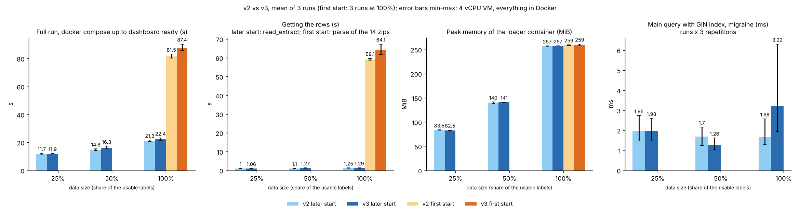
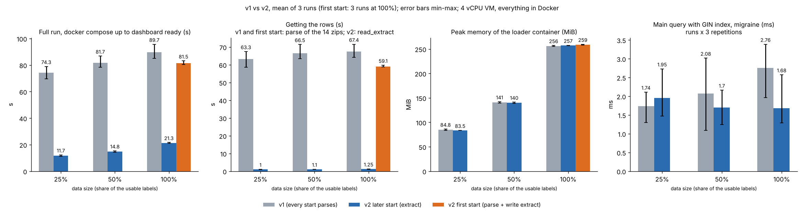

# Measurements: v1, v2 and v3

The main README keeps seven key numbers. This file has the whole table, the protocol, the verdict rule, the experiments and what each review round changed. Three benchmarks, all on the same machine, all kept unchanged:

- **v1** (`measure/results/`): the first loader, which parsed the 14 zips on every start. Predictions: `measure/predictions.md`, written before any result.
- **v2** (`measure/results_v2/`, 5 Nov 2026, 17:57-18:14 UTC): after review round 1. The loader parses the zips once into an extract (`data/clean/`), the load is one transaction, TCP keepalives are set. **Nothing was predicted before v2** (review round 2): its new rows are marked "not predicted".
- **v3** (`measure/results_v3/`, 20:27:53-20:45:42 UTC): after review round 2. The extract name carries `clean_version`, and a later start returns before the zips are checked. Predictions: `measure/predictions_v3.md`, committed at 20:27:31 (`dcbefbf`), 19 s before the first line of `results_v3/benchmark_log.txt`. Verdicts: `measure/results_v3/verdicts.md`.

**Machine:** 4 vCPU Intel Xeon @ 2.80 GHz, 15.7 GiB RAM, Ubuntu 24.04.5 cloud VM (not a laptop), Docker 29.9.2, Compose 5.6.1, PostgreSQL 16.15, loader on Python 3.12.16 with ijson 3.6.0 (`yajl2_c`) and psycopg 3.3.6. The postgres, python and loader image ids are recorded (the app's is not) because `postgres:16` and `python:3.12-slim` move (`results_v2/machine.txt`, `results_v3/machine.txt`: the postgres and python ids are the same in both). Here `python:3.12-slim` is a VM-only variant with the proxy's CA bundle (`docs/environment.md`, item 3). **Everything ran in Docker.**

**Protocol (v2 and v3).** The same command, `python3 measure/benchmark.py --drop-caches --first-start 3` with its own `--out` folder (`measure/how_to_reproduce.md`): 3 runs per size, interleaved and rotated (25-50-100, 50-100-25, 100-25-50), then 3 first starts at 100% that delete `data/clean` first. Every run gets a fresh database volume and an emptied OS file cache (`os_cache_dropped` = 1 in all 12 runs, in both). `data/clean` is kept between the other runs, as on a normal later start. Each query gets 1 warm-up and 3 timed runs (on the fly: 1). The download is excluded. The load average is read twice. In v2, before `down -v` it was 1.69 / 1.68 / 2.30 at 25 / 50 / 100%, mostly the previous run's tail; after `down -v`, the cache drop and a 30 s settle it was 1.03 / 1.08 / 1.39, and 1.25 → 0.83 for the first starts. v1 read it once, right after `down -v`: 2.1 / 2.4 / 2.1. In v3, after the settle, the first starts read 1.02 / 0.82 / 0.82 (`results_v3/verdicts.md`). The first starts run last, so first start against later start is not interleaved.

**Prediction verdicts, one rule:** gap = (measured − predicted) / predicted. |gap| ≤ 10% is confirmed, ≤ 25% is close, anything else is missed.
- **v2 against `predictions.md` (P-numbers):** "known before" means that size's value was already in the "What we already knew" table of `predictions.md`, so matching it proves nothing. Most rows were therefore blind only at 50%. P1, P6 and P7 predicted the v1 parse path, so they are not applied to later starts.
- **v3 against `predictions_v3.md` (Q-numbers):** every row had a v2 value on the same protocol, so **every v3 verdict is known before** (v2), and the 13 rows marked v3ev also had a v3-code value before the prediction. Only Q26-Q27 (the `docker stats` sample count) had nothing behind them. Tally: 64 values, 51 confirmed, 11 close, 2 missed; 58 inside the written range. A match shows that the benchmark repeats, not that our model of the pipeline is right.

**One change at a time? Not between versions.** Between v1 and v2 several things changed at once: the loader path (extract), the one transaction, keepalives, images rebuilt with constraint files, the schedule (no `tsv`-after run, a 30 s settle) and the machine load. Only the parse → read-extract gap, far larger than the noise, is put down to one change (the extract). The other v1 → v2 differences (COPY, GIN build, the query with the index) are not attributable. Between v2 and v3 the timed code changed only in the download step of a later start (4 ms saved); every other difference is this machine's run-to-run noise between two series about 2.5 hours apart (Judgement, `results_v3/verdicts.md`): 0-9% either way for the full run, the pipeline, COPY and the parse at 100%, more for short values, e.g. the GIN build +19% and the migraine query with the index +92% (1.68 → 3.22 ms, Q14) at 100% (arithmetic). So a difference under about 10% between two benchmarks here supports no claim, and on a step under 2 s or a query of a few ms not even a larger one.

## The whole table

Means of 3 runs (queries: 3 runs × 3 repetitions) from `results/summary.csv` (v1), `results_v2/summary.csv` and `results_v3/summary.csv`; every value is in each folder's `raw_runs.csv`. Cells read "v2 → v3"; "=" means the same value in both. The std of the per-run means of the migraine query with the index is 0.27 / 0.25 / 0.36 ms in v2 and 0.38 / 0.18 / 1.33 ms in v3 (`run_mean_std`).

| Step | 25% v2 → v3 | 50% v2 → v3 | 100% v2 → v3 | v1 at 100% | What the numbers mean |
|---|---|---|---|---|---|
| Labels loaded | 19,546 = | 39,042 = | 78,472 = | 78,472 | Hash buckets of `set_id` give the same mix of labels at every size (D-2). Known before. v3 Q17: confirmed ×3. |
| `download` step (later start; the zips are on disk) | 0.0127 → 0.0077 s | 0.0107 → 0.0084 s | 0.0116 → 0.0076 s | 0.0135 s | v3 no longer opens the 14 zips when the extract exists: about 4 ms saved, invisible in the full run. Q1: confirmed / close / confirmed. |
| Get the rows: read the extract (later start) | 1.00 → 1.06 s | 1.10 → 1.27 s | 1.25 → 1.29 s | parse 67.43 s | 54× shorter than v1's parse in v2 (arithmetic), because 74.4 MB of CSV replaces 8.75 GB of JSON; "The fastest read is the one that never happens." v2: not predicted (new path). Q2: confirmed / close / confirmed. |
| … parse the 14 zips + write the extract (first start) | | | 59.07 + 1.45 → 64.09 + 1.39 s | 67.43 s | Compute-bound in one Python process (v2 loader median 99.8% CPU, `results_v2/docker_stats_samples.csv`). v2's 8.4 s below v1 may be v1's round-1 slowdown (Judgement, "round effect" below). v3's parse is 8.5% slower on the same parse code; the cause was not found. P1 67 s: known before. Q10 confirmed (+8.4%, outside its range), Q11 confirmed. |
| COPY (`tsv` stemmed by PostgreSQL) | 2.94 → 2.68 s | 5.26 → 5.78 s | 10.62 → 10.90 s | 11.85 s | Linear and the largest step, with `db` at about one core (v2, `docker stats`); "The bottleneck is rarely the part you suspected." Per row (arithmetic): v2 151 / 135 / 135 µs, v3 137 / 148 / 139 µs; without the first run of the series that has an outlier (v2 25%: 3.56 s; v3 50%: 6.26 s) it is 134.7 µs (v2 25%) and 142.0 µs (v3 50%), so the spread is one run, not size. P2 3.1 / 5.8 / 11.0 s: known before / confirmed (−9%) / known before. Q3: close / confirmed / confirmed. |
| GIN index build | 0.31 → 0.34 s | 0.67 → 0.73 s | 1.31 → 1.56 s | 1.63 s | Paid once per load; an index is "one more copy of your data, kept in the order that answers a particular question". P3 0.40 / 0.75 / 1.5 s: known before / close (−10.4%) / known before. Q4: confirmed / confirmed / close. |
| `drugs` table (one `GROUP BY`) | 0.05 → 0.06 s | 0.12 → 0.14 s | 0.21 → 0.27 s | 0.25 s | One pass over the short columns: linear and small. P4 0.07 / 0.12 / 0.20 s: known before / confirmed (−0.4%) / known before. Q5: close ×3. |
| ANALYZE | 0.52 → 0.57 s | 0.94 → 0.94 s | 0.96 → 1.05 s | 1.11 s | A sample of 30,000 rows from 50% on, so 50% ≈ 100% (Judgement, `predictions_v3.md` Q6). Q6: confirmed ×3. |
| Pipeline after the download (later start) | 4.89 → 4.77 s | 8.16 → 8.95 s | 14.44 → 15.17 s | 82.36 s | COPY is 60-74% of it in v2 and 56-72% in v3 (arithmetic), so the load now grows with the data. P6 not applied. Q7: confirmed ×3. |
| Full run, `up` to dashboard ready (later start) | 11.71 → 11.93 s | 14.82 → 16.30 s | 21.32 → 22.37 s | 89.74 s | 4× the data takes 1.82× (v2) and 1.88× (v3) the time, with 6.6-6.9 s (v2) and 7.2-7.4 s (v3) that do not grow (full run minus pipeline, arithmetic). Split in `docs/evidence/v3_startup_breakdown.txt`: db start to healthy 3.11 s (44%, about half initdb, half the wait for the first 3 s healthcheck), Streamlit start 1.31 s. "Amdahl’s law: the serial part wins." P7 not applied. Q8: confirmed ×3. The first run of every v3 later-start series was the longest (12.18 / 17.30 / 23.18 s; Q28 right); among first starts run 3 was (90.35 s). |
| Full run, first start (extract deleted, zips on disk) | | | 81.48 → 87.44 s | 89.74 s | What a new user waits once the zips and images are there (v3 min 85.75, max 90.35 s). It excludes the download and the build: the one cold run, by the README tester, took 74.0 s of build + 97.8 s from `up`. P7 92 s: close (−11%; against v1 −2.5%, confirmed). Q13 confirmed (+7.2%, outside its range). |
| Main query, migraine, with the GIN index | 1.95 → 1.98 ms | 1.70 → 1.26 ms | 1.68 → 3.22 ms | 2.76 ms | The index lets PostgreSQL "find matching rows without reading the whole table". Inside the database: 1.55 ms in v2 against v1's 1.51 ms, and in v3 the plan has the same `shared hit=755` as v2 (`explain/` plans). So the v1 → v2 → v3 differences are outside PostgreSQL: at 1-6 ms it is mostly the round trip and the scheduler (Judgement). P10 2.5 / 2.7 / 3.0 ms: known before / missed (−37%) / known before. Q14: close / missed / missed. |
| … without the index | 20.69 → 21.12 ms | 51.19 → 56.89 ms | 83.61 → 82.34 ms | 103.33 ms | A Seq Scan of every stored `tsv` with no parallel worker at any size (plans; why: "parallel scan" below), so the index is 10.6× / 30.2× / 49.8× faster in v2 and 10.7× / 45.0× / 25.6× in v3 (arithmetic): the ratio moves with the noise of the 1-6 ms side. P12 30 / 45 / 75 ms: known before / close (+14%) / known before; P13 12 / 17 / 25×: known before / missed (+78%) / known before. Q15: confirmed / close / confirmed. |
| … on the fly (`to_tsvector` in the query) | 1,156 → 1,175 ms | 1,464 → 1,793 ms | 2,998 → 3,214 ms | 3,566 ms | Every label is stemmed again for every query (1 / 2 / 2 parallel workers), so the stored column is 36× (v2) and 39× (v3) faster even without the index at 100% (arithmetic); all modes give the same answer (`check_same_answer_migraine` = 1). P14 1.4 / 1.8 / 3.6 s: known before / close (−19%) / known before. Q16: confirmed / close / confirmed. |
| Drill-down `labels_for_drug`, with the index | 5.03 → 5.08 ms | 5.04 → 5.81 ms | 5.62 → 6.17 ms | 6.23 ms | Always 20 rows, and `ts_headline` on them is most of the 5.13 ms v2 plan at 100% (v2 also filters by Rx/OTC, `2d103b4`). P15 4 / 4.5 / 5 ms: missed (+26%) / close (+12%) / close (+12%). v3: not predicted. |
| … without the index | 26.85 → 23.88 ms | 45.38 → 49.45 ms | 89.07 → 92.01 ms | 94.81 ms | The same sequential scan, because there is no index on `substance_key` (`docs/schema.md`). P16 30 / 45 / 75 ms: close (−10.5%) / confirmed (+0.8%) / close (+19%). v3: not predicted. |
| Disk: 14 zips / JSON inside | 1,858.9 / 8,749.7 MB = | same | same | same | Read in full on every first start, at every size. Since v3, a later start no longer needs the zips on disk: 74,989,727 bytes (extract + manifest) instead of 1,933,295,489, 25.8× less (`docs/evidence/v3_extract_without_zips.txt`). Known before. |
| Disk: extract `data/clean` (all four buckets) | 74.4 MB = | 74.4 MB = | 74.4 MB = | none | 4.0% of the zips (arithmetic), written once; "Filter and select early". v3 is byte-identical to v2 (74,388,073 bytes), only the name changed. v2: not predicted. Q20: confirmed ×3. |
| Disk: kept indications text | 13.7 MB = | 26.9 MB = | 54.4 MB = | 54.4 MB | The text that reaches the database, 0.6% of the JSON at 100% (arithmetic). P28 13 / 26 / 52 MB: confirmed (+5%, +4%, +5%). |
| Disk: `labels` heap / TOAST | 17.9 / 10.2 MB = | 36.0 / 20.0 MB = | 71.8 / 40.6 MB = | 71.8 / 40.6 MB | Linear; long values (long Rx texts and their `tsv`) are compressed into TOAST. P19, P20: known before / confirmed (+0.7%, −1.6%) / known before. |
| Disk: `tsv` / `indications` columns as stored | 11.7 / 8.8 MB = | 23.0 / 17.4 MB = | 46.5 / 35.1 MB = | 46.5 / 35.1 MB | The stemmed words take more room than the compressed text they come from, which is the price of fast search. P24: `tsv` confirmed (+6%, +5%, +3%), `indications` close (−12%, −13%, −12%). |
| Disk: GIN index | 3.4 MB = | 6.3 MB = | 11.5 MB = | 11.5 MB | Less than linear, because the vocabulary grows more slowly than the labels. P21: known before / confirmed (−0.1%) / known before. |
| Disk: database (`pg_database_size`) | 41.3 MB = | 73.8 MB = | 138.3 MB = | 138.2 MB | 2.2% / 4.0% / 7.4% of the zips (arithmetic), because 70% of the labels and most of each label never reach the database. P25 41 / 73 / 138 MB: known before / confirmed (+1.1%) / known before. Q18: confirmed ×3 (first start Q19 confirmed). |
| Peak memory `loader` | 83.5 → 82.5 MiB | 140.1 → 140.8 MiB | 257.4 → 257.4 MiB | 256.2 MiB | It grows with the kept rows, held in a list until COPY (D-4); "Look at the highest value, while the heaviest step runs." P29 90 / 125 / 200 MiB: known before (as RSS) / close (+12%) / known before. Q21: confirmed ×3. |
| Peak memory `db`, load / queries | 122.4 / 101.8 → 98.7 / 101.5 MiB | 169.0 / 189.1 → 168.6 / 188.8 MiB | 234.5 / 269.2 → 234.7 / 269.2 MiB | 237.1 / 257.6 MiB | It grows with the data, but on cgroup v1 `docker stats` counts part of the file cache (`docs/environment.md`, item 4); that is why the 25% load peak fell 23.7 MiB with the same rows (Judgement). P30: close (−24%, −16%, −13%); P31: missed (−40%) / confirmed (−9.9%) / confirmed (−4%). Q22: close / confirmed / confirmed; Q23: confirmed ×3. |
| Peak memory `app`, load / queries | 52.9 / 55.2 → 53.1 / 55.5 MiB | 52.8 / 61.3 → 53.0 / 58.9 MiB | 52.8 / 57.5 → 53.1 / 57.9 MiB | 54.5 / 62.0 MiB | Flat because no browser was connected; serving a browser it peaked at 138.4 MiB ("app memory" below). P32 130 MiB: missed (−59%). Q24: confirmed ×3. |
| `docker stats` samples written (all 12 runs) | | | 2,791 rows (1,413 unique) → 1,487 rows, 0 duplicates | 5,316 rows (2,694 unique) | v2 wrote every reading twice (two overlapping calls return the same daemon reading); `d794808` writes each once. Distinct readings are about 1 s apart. Peaks unchanged. Q26 right, Q27 confirmed (+6.2%, new). |

**Cost**: the person who runs it pays. A first start costs the download, the build and the parse: 171.8 s cold in the README test (74.0 s build + 97.8 s from `up`, arithmetic), 87.4 s in benchmark v3 with the zips and images already there. Every later start costs 22.4 s (v3). Disk is 1.86 GB of zips (now deletable after the first start) + 74.4 MB extract + 138.3 MB database + 1.69 GB of images (`results_v3/machine.txt`: 220 + 829 + 636 MB). The extract is the smaller design: 74.4 MB of disk and 1.39 s once, in exchange for 65.1 s off every later start (87.44 − 22.37 s in v3, arithmetic; the first starts ran last).

## Experiments, one change at a time

All in `measure/results_experiments/`, on the v2 code.
- **GIN expression index instead of the stored `tsv`** (100%, 3 loads each). It would save disk: the database drops from 138.1 to 88.7 MB and COPY from 10.72 to 1.42 s. But the index build grows from 1.40 to 10.84 s, ANALYZE from 1.23 to 4.55 s, and the pipeline from 14.96 to 18.44 s. Migraine stays at 1.86 → 1.90 ms, while "type 2 diabetes" goes from 10.4 to 470 ms, because the recheck must stem its rows again. The answers are the same, and we keep the stored column (Judgement) (`gin_expression/summary_table.txt`).
- **Parallel scan.** Without the index, the planner prices the scan at 10,015.70 serial against 10,487.51 with 2 workers (9,487.51 + the setup cost of 1000, arithmetic), so the setup cost alone keeps the workers out. Forcing them cuts the scan from 82.1 to 46.8 ms in the database and from 90.2 to 44.0 ms from Python. The index is still 46.5× faster (`parallel_scan/run.txt`, `stats.txt`).
- **App memory with a browser** (playwright at 100%: 16 searches with drill-down in 41.5 s, 0 errors). The app goes from a 46.5 MiB idle median to a 138.4 MiB peak and stays at 132.8 MiB after the browser closes. `db` peaks at 217.8 MiB while the browser ran (218.8 MiB after it closed). Samples are about 1 s apart (`app_memory/output.txt`, `peaks.csv`).
- **Round effect in v1.** Round 1 was slower by +6.18 / +7.37 / +6.20 s of parse at 25 / 50 / 100%. Each size ran once per round, so interleaving cancels this between sizes, and removing it cuts the parse std from 4.40 / 4.32 / 3.75 to 2.34 / 1.08 / 1.37 s. The cause is unknown; the load average was 0.21 before round 1 started (`round_effect/output.txt`, `by_round.csv`). In v2 and v3 the first run of a series is again often the slowest (COPY above; v3 full runs, Q28); we did not add an untimed warm-up start.

## What each review round changed

**Round 1 → v2.** The loader now parses the zips once into a 74.4 MB extract, so a later start at 100% fell from 89.7 to 21.3 s and getting the rows from 67.4 to 1.25 s (the first start, 89.7 → 81.5 s, ran last, so that comparison is not like for like). The whole load is now one transaction, 's "a group of changes that happens completely, or not at all": a loader killed during COPY left the previous 78,472 labels intact, and because the loader now sets TCP keepalives, the dead session was gone 25.5 s after the kill instead of still holding its lock 5.5 minutes later (`docs/evidence/v2_atomic.txt`). On the restart path v1 never ran, `/_stcore/health` answered in 1.8 s, a zip of the wrong size is now re-checked against the live manifest, both images pin 36 + 4 packages (`ffdd697`), and the drill-down follows the Rx/OTC choice ("9 of 1 labels" → "1 of 1", `docs/evidence/v2_drilldown_filter.txt`). One cost is new: a 25% parse now peaks at 178 MiB RSS instead of 74 MiB, because it keeps all four buckets for the extract (`docs/evidence/v2_second_start_25pct.txt`).

**Round 2 → v3** (merge `7032f94`; evidence `docs/evidence/v3_*.txt`). Behaviour, not speed:
- The extract key: a changed cleaning rule now means a new parse (main reused the stale extract, kept=19546; v3 parsed, kept=19202, 67.7 s at 25%, `v3_extract_key.txt`).
- Extract before zips: with only the extract and the manifest on disk, a later start loads 78,472 labels (16.4 s for the loader); with no manifest and no network it stops with exit 1 after 66.6 s and names the extract, instead of guessing the export (`v3_extract_without_zips.txt`).
- A missing zip after a new export: main looped on "Delete it and run again"; v3 stops with the "new export" message in 3.0 s (`v3_missing_zip.txt`). An HTTP 4xx answer (not 429) is no longer retried: 67.3 → 2.1 s (`v3_http_4xx.txt`).
- Measured, not changed: retries wait 2.2 / 4.8 / 9.0 / 16.2 / 32.4 s and give up after 64.61 s (`v3_retry.txt`); after a loader exit 1 under `docker compose up` the app is never started and `db` is left running (`v3_app_waits_for_loader.txt`); a reload while the page is open makes one read wait 14.3-15.8 s and never shows an empty table (`v3_reload_lock.txt`; loading into a new table and renaming it is written up as Judgement, not built).
- Benchmark v3 then showed no speed change beyond noise (table above). Nothing fixes the one-day, one-author history.

## Charts

`results_v3/v2_vs_v3.png` (`measure/charts_v2_v3.py`), `results_v2/v1_vs_v2.png` (`measure/charts_v1_v2.py`); per version, drawn by `measure/charts.py`: `time_vs_size.png` (each step against its dashed linear line), `query_modes.png`, `disk_db_vs_raw.png` and `memory_peak.png` in `results_v2/` and `results_v3/`. The v1 charts are in `results/`. To reproduce: `measure/how_to_reproduce.md`.

