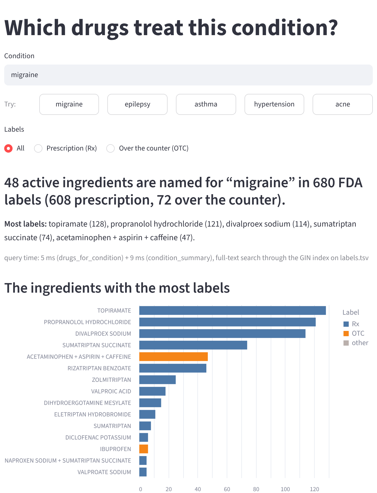
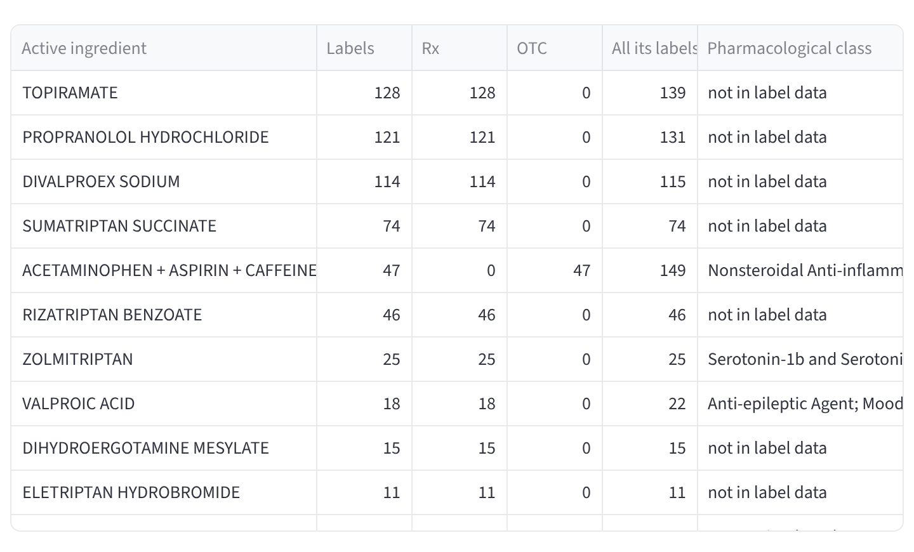
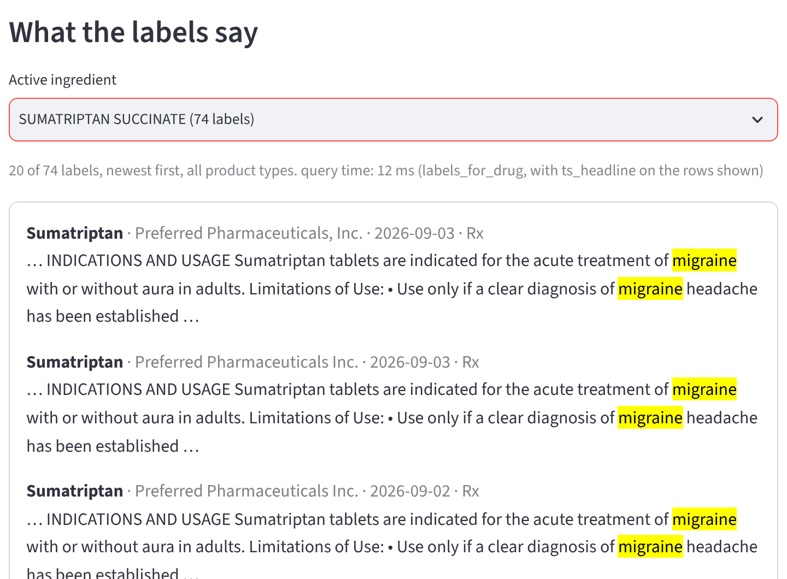
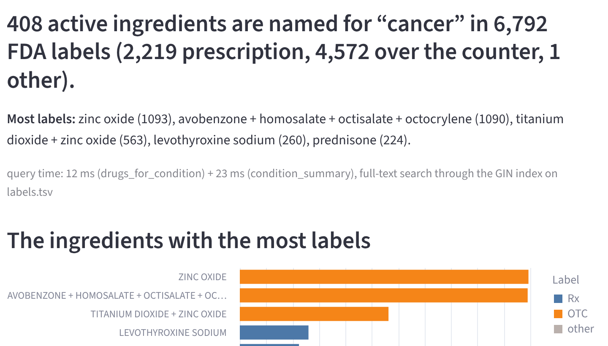
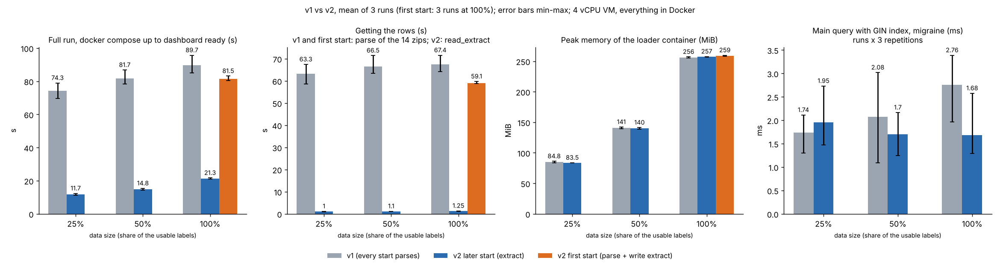
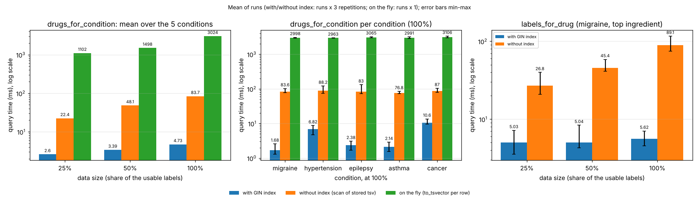
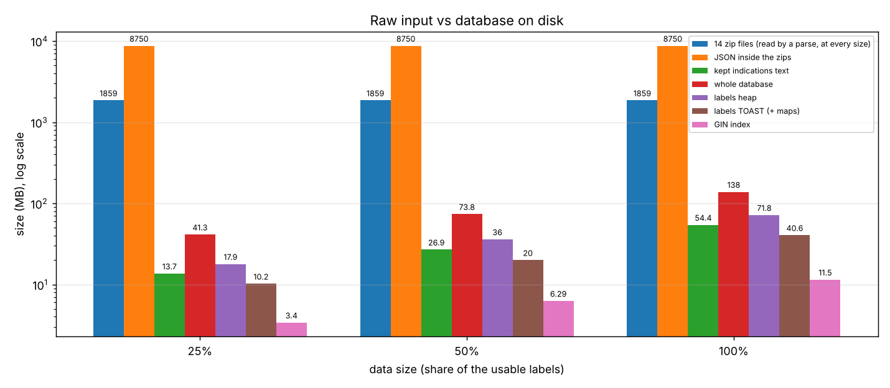
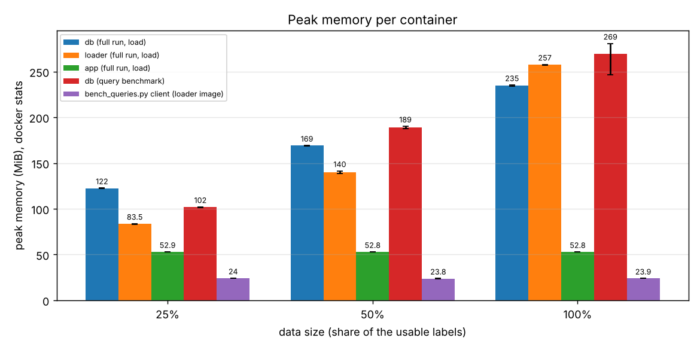

<style>
section {
  font-family: "Helvetica Neue", Arial, sans-serif;
  font-size: 26px;
  padding: 44px 60px 50px 60px;
  color: #1d1d1f;
  justify-content: flex-start;
}
h1 { font-size: 36px; color: #12385f; margin: 0 0 16px 0; line-height: 1.2; }
h2 { font-size: 28px; color: #12385f; margin: 0 0 10px 0; }
table { font-size: 20px; border-collapse: collapse; margin: 0; }
th { background: #e8eef5; }
th, td { padding: 4px 10px; }
code { font-size: 0.92em; }
pre { font-size: 18px; margin: 6px 0; }
ul { margin: 4px 0; }
li { margin: 3px 0; }
p { margin: 6px 0; }
.small { font-size: 16px; color: #555; }
.note { font-size: 18px; color: #333; }
.big { font-size: 30px; }
.cols { display: grid; grid-template-columns: 1fr 1fr; gap: 28px; align-items: start; }
.cols-wide { display: grid; grid-template-columns: 1.15fr 1fr; gap: 24px; align-items: start; }
.cols-shot { display: grid; grid-template-columns: 520px 1fr; gap: 26px; align-items: start; }
.shot { border: 1px solid #ccc; display: block; }
.tight td, .tight th { padding: 3px 8px; }
.tight table { font-size: 18px; }
.mid { font-size: 22px; }
.mid li { margin: 2px 0; }
.sm { font-size: 19px; }
.sm li { margin: 1px 0; }
.wrong table { font-size: 16px; }
.wrong td, .wrong th { padding: 3px 7px; }
.wrong td:first-child { width: 33%; }
.plan table { font-size: 16px; }
.pred table { font-size: 16px; }
.pred td, .pred th { padding: 2px 7px; }
.plan td, .plan th { padding: 2px 8px; }
section::after { font-size: 16px; }
footer { font-size: 14px; color: #888; }
header { font-size: 15px; color: #888; }
</style>

<!-- header: '1, Question and data (3 min)' -->

# Type "migraine": 48 active ingredients, named in 680 FDA labels

<p class="big"><b>Question.</b> Which drugs treat this condition? You type a condition; you see the active ingredients whose FDA label names it under "Indications and usage".</p>

- For each ingredient: how many labels, prescription (Rx) or over the counter (OTC), and its class when the label has one
- **Migraine**, all the data: **48** ingredients, **680** labels (**608** Rx, **72** OTC). First: topiramate, **128** labels
- The answer comes back in milliseconds: **1.68 ms** in benchmark v2, **3.22 ms** in v3, the same plan (mean of 9, with the index)
- A label names a condition. It is not a medical database. **Not medical advice.**

<br>

Alessandro, Andrea, Federico, Giacomo, Giulia

<p class="small">Numbers: <code>measure/results_v2/summary.csv</code> and <code>measure/results_v3/summary.csv</code> (100%, mode generated), <code>docs/evidence/core_queries_100pct.txt</code>.</p>

<!--
SPEAKER: Role A (data and loading). TIME: 1:00. Section 1, Question and data, 3:00 in total. Running total 1:00 of 15:00.

Good morning.
Our question is one a friend understands. Which drugs treat this condition?
You type a condition, for example migraine.
We show the active ingredients whose FDA label names it, in the section "Indications and usage".
For migraine: 48 ingredients, in 680 labels. 608 prescription, 72 over the counter.
The first one is topiramate, with 128 labels.
The answer takes a few milliseconds.
One warning first. A label that names a condition is not proof that a drug treats it. This is not medical advice. We show where it breaks in the demo.
-->

---

# 262,907 labels in 1.86 GB of zips; 78,472 of them (29.8%) can answer

<div class="tight">

| | |
|---|---|
| **Source** | openFDA drug label bulk export: manifest `api.fda.gov/download.json`, 14 zip files, export of 5 Nov 2026 |
| **Licence** | CC0 1.0 Universal (open.fda.gov/license). Product labels of companies: no personal data |
| **Size** | **1,858,907,416 bytes** of zips; **8,749,654,318 bytes** of JSON inside. Streamed with ijson, one label at a time: nothing is unzipped |
| **Dropped** | no harmonised ingredient name (no `openfda` block): **172,514**; no indications text: **11,921** |
| **Kept** | **78,472** labels: 33,392 Rx, 45,062 OTC, 18 other. Since v2 also written once to `data/clean`: one CSV of **74,388,073 bytes**; since v3 its name carries an md5 of the cleaning code |
| **Sizes** | 25% / 50% / 100% = hash buckets of the label id: **19,546 / 39,042 / 78,472** labels |

</div>

<p class="note">262,907 − 172,514 − 11,921 = 78,472 (arithmetic). The loader downloads the files by script, no key, no login.</p>

<p class="small"><code>docs/dataset_decision.md</code>; <code>docs/decision_log.md</code> D-2, D-8, D-17; <code>measure/results_v2/machine.txt</code>; CSV size: <code>docs/evidence/v2_first_start_100pct.txt</code>; its name: <code>v3_extract_key.txt</code>. Ten datasets were scored; SIDER and the EMA table were the runners-up.</p>

<!--
SPEAKER: Role A. TIME: 1:00. Section 1, Question and data. Running total 2:00 of 15:00.

The data is the openFDA drug label export. The licence is CC0: anyone can use it.
It is 14 zip files, 1.86 gigabytes. Inside, 8.75 gigabytes of JSON.
That is too big to load into memory at once. So the loader reads one label at a time, straight from the zip, with a library called ijson.
Most labels cannot answer our question. 172,514 have no harmonised ingredient name. 11,921 have no indications text.
78,472 are left. That is 29.8 percent.
Since version 2, the loader writes those rows once to a 74-megabyte CSV file. Since version 3 its name carries a checksum of the cleaning code, so new rules mean a new parse. I show what that changed in the measurements.
For the three sizes we split the labels by a hash of their id. A quarter is 19,546 labels. They are the same kind of labels at every size.
We checked ten datasets. SIDER already has the answer coded, but it is from 2015 and too small to measure.
-->

---

# The JSON is nested; we flatten it to 13 columns, so PostgreSQL fits

<div class="cols-wide">
<div>

```sql
CREATE TABLE labels (
  set_id UUID PRIMARY KEY,
  substance_key TEXT,     -- "TOPIRAMATE"
  product_type TEXT,      -- Rx | OTC
  pharm_class_epc TEXT, ...
  indications TEXT,
  tsv TSVECTOR GENERATED ALWAYS AS
      (to_tsvector('english', indications)) STORED);
CREATE INDEX labels_tsv_gin ON labels USING gin (tsv);
```
<p class="small">Shortened from <code>sql/schema.sql</code>, <code>sql/indexes.sql</code>. A second table, <code>drugs</code>, is one <code>GROUP BY</code> of <code>labels</code>: 8,157 rows.</p>

</div>
<div class="mid">

- **Raw:** four labels read by hand have 19 to 47 sections. NoSQL is for records that "have different fields, or are nested, like JSON from a website."
- **Kept:** 13 fields of 29.8% of the labels. Now "Every row has the same columns."
- **The work:** count labels per ingredient. That is SQL.
- **The search:** stemmed words ("migraines" → `migrain`), stored once, with an inverted GIN index.

</div>
</div>

<p class="note">"A database is chosen for the shape of the data, not out of habit." Judgement: MongoDB would win if we kept whole labels (<code>docs/schema.md</code>, D-14).</p>

<!--
SPEAKER: Role B (database and queries). TIME: 1:00. Section 1, Question and data. Running total 3:00 of 15:00.

Why PostgreSQL, when the data is JSON?
The raw labels look like the NoSQL case of nested, with different fields. One label has 19 sections, another 47.
But we keep only 13 fields, from 30 percent of the labels. After that, every row has the same columns.
And the work is counting labels per ingredient. That is SQL.
PostgreSQL also has the search we need. The column tsv holds the words of the indications, stemmed: "migraines" becomes "migrain".
It is computed once, when the row is written, and stored.
On top of it, one GIN index: for each word, the list of labels that contain it.
If we kept whole labels and asked many questions of them, MongoDB would be the better choice. That is our judgement.
Now Role D shows how it runs.
-->

---

<!-- header: '2, Architecture (2 min)' -->

# Three containers start with one command: `docker compose up`


- **db**: PostgreSQL 16; the data lives in the named volume `dbdata`
- **loader**: Python, one-shot: download, stream-parse, clean; then `COPY`, GIN index and `drugs` table in **one transaction**; exit 0
- **app**: Streamlit on port 8501, the only port opened to the host
- `./data/raw`: the 14 zips (since v3 only a parse reads them). `./data/clean` (since v2): the kept rows, one CSV. Never in git

<!--
SPEAKER: Role D (Docker, README, diagram). TIME: 1:00. Section 2, Architecture, 2:00 in total. Running total 4:00 of 15:00.

Inside the dashed line, one box is one container. Three containers.
Follow the arrows. The manifest and 14 zip files come from openFDA over HTTPS into the loader.
The zips are saved once in data/raw on the host.
The loader streams the labels, keeps the usable ones, and sends them to the database with one COPY.
Since version 2 it also writes the kept rows to data/clean, the box left of the loader. Since version 3 a later start reads only that file and does not look at the zips.
Then it builds the GIN index and the drugs table, and commits everything at once. A failed load leaves the previous one as it was.
The app sends one SQL query per search, and gets back 25 rows. It serves a web page on localhost 8501.
-->

---

# Start order in compose: 87.4 s on a first start, 22.4 s later

<div class="cols-wide">
<div>

```yaml
db:
  image: postgres:16
  volumes: [dbdata:/var/lib/postgresql/data]
  healthcheck:
    test: pg_isready -U $${POSTGRES_USER} ...
loader:
  environment: {EXTRACT_CACHE: ${EXTRACT_CACHE:-1}, ...}
  volumes: [./data:/data]   # raw/ and clean/
  depends_on:
    db: {condition: service_healthy}
app:
  ports: ["${APP_PORT:-8501}:8501"]
  depends_on:
    loader:
      condition: service_completed_successfully
```
<p class="small">Shortened from <code>docker-compose.yml</code>.</p>

</div>
<div class="sm">

- The loader starts when the database answers `pg_isready`; the app only after the loader exits with success. Tested in v3: after a loader exit 1 the app stays "created", never started
- Services find each other by name: `DB_HOST=db`
- `down` keeps the data. `down`, then `up -d --no-deps db app`: 78,472 labels, migraine still 680 / 48 (slide 6)
- "Dependencies first, your code last.". Non-root UID 1000. Since v2 every package is pinned by a constraints file
- **Full run** at 100%, `up` until Streamlit answers: first start **87.4 s**, later start **22.4 s** (v2: 81.5 / 21.3 s; v1: 89.7 s every time)
- First start from a fresh clone (cloud VM), 1.86 GB download included: **97.8 s** (download 14.9 s)

</div>
</div>

<p class="small">Mean of 3, <code>measure/results_v3/summary.csv</code>, <code>full_run</code> (modes <code>first_start</code>, <code>generated</code>); v2: <code>results_v2/</code>; v1: <code>results/</code>. The benchmark's zips were already in <code>data/raw</code>. Exit 1: <code>docs/evidence/v3_app_waits_for_loader.txt</code>.</p>

<!--
SPEAKER: Role D. TIME: 1:00. Section 2, Architecture. Running total 5:00 of 15:00.

The start-up order is written in the compose file. It is the pattern of, exercise 4.
The database has a healthcheck: pg_isready. The loader waits until it is healthy. So no "connection refused".
The app waits until the loader has finished with success. So the page never shows an empty table. In version 3 we broke the loader on purpose: the app container was created and never started.
Containers talk by service name, db. Never localhost.
The data lives in a named volume. docker compose down keeps it.
From docker compose up until Streamlit answers, at 100 percent: 87 seconds the first time, 22 seconds after that. Version 1 took 90 seconds every time. Role A explains why in the measurements.
From a fresh clone on the same machine, following the README: 98 seconds, with the 1.86 gigabyte download.
Now Role C runs the demo.
-->

---

<!-- header: '3, Live demo (3 min)' -->

# The demo skips the load: `--no-deps` serves the kept volume

<div class="mid">

**Before the talk** (once): `docker compose up -d` loads all 78,472 labels. **On stage:**

```bash
docker compose down
docker compose up -d --no-deps db app
```

Tested in v2: Streamlit's health check answered **1.8 s** after `up`, but it does not query the database (db was still starting). The page drew the migraine answer within **14 s** (AppTest). So: wait a few seconds before typing.

1. Open **http://localhost:8501**
2. Type **migraine**: the answer sentence, the chart, the table
3. In "What the labels say", pick **sumatriptan succinate**
4. Click **Try "cancer"**

**If the live demo fails:** play `docs/demo_dashboard.webm` (browser, **61 s**) or `docs/demo_recording.cast` (terminal, **82 s**); the next two slides are screenshots.

</div>

<p class="small"><code>docs/evidence/v2_restart_no_deps.txt</code>: health 200 at 1.8 s (line 41), <code>db</code> "health: starting" (45), AppTest headline (72), both "healthy" 14 s after creation (75-76). Lengths: <code>ffprobe</code> of the webm (60.7 s), last event of the cast (81.8 s); both from <code>8cfddb6</code>, before v2: they show the v1 page.</p>

<!--
SPEAKER: Role C (processing and output). TIME: 0:45. Section 3, Live demo, 3:00 in total. Running total 5:45 of 15:00.

We loaded the data before the talk.
Now I stop everything with docker compose down. The volume stays.
Then I start only the database and the app. No-deps means: do not start the loader.
Nothing is reloaded. In our test Streamlit answered after 1.8 seconds, but that check does not touch the database. The page drew the migraine answer within 14 seconds. So I wait a few seconds before I type.
If this fails, I play our recording: one minute of the browser, and the terminal part. It was made before version 2.
 asks for exactly that: "BACKUP: Record a 2-minute video of the demo. If the live demo fails, play it."
Switch to the browser now.
-->

---

# Migraine: topiramate leads with 128 of 680 labels, all prescription

<div class="cols-shot" style="grid-template-columns: 420px 1fr;">
<div>

</div>
<div class="mid">

1. **The answer** in one sentence
2. **The chart:** top 15 ingredients; blue Rx, orange OTC
3. **The table:** top 25, with each ingredient's class
4. **Query time** on the page: 5 + 9 ms, one cold call. Benchmark mean (9, warm): **1.68 ms** v2, **3.22 ms** v3



</div>
</div>

<p class="small">Cropped from <code>docs/screenshots/dashboard_migraine.png</code> (all the data). 1.68 / 3.22 ms: <code>measure/results_v2/</code>, <code>results_v3/summary.csv</code>.</p>

<!--
SPEAKER: Role C. TIME: 1:15 (in the browser; this slide is the backup). Section 3, Live demo. Running total 7:00 of 15:00.

I type migraine.
At the top, the answer in one sentence. 48 active ingredients, in 680 labels: 608 prescription, 72 over the counter.
Below, the chart. Topiramate first, 128 labels. Then propranolol, divalproex, sumatriptan. They are all prescription drugs.
The orange bar is over the counter: acetaminophen, aspirin and caffeine. That is a headache pill.
Under the sentence the page prints how long the query took: 5 milliseconds here, one call, just after a restart. The benchmark means, warm, are 1.7 and 3.2.
Scroll down. The table shows the class of each ingredient. Most say "not in label data". We do not guess. I come back to that.
-->

---

# The search finds words, not meaning: "cancer" brings sunscreens

<div class="cols">
<div>

<div class="mid">

- **Drill-down:** 20 of sumatriptan's 74 labels, newest first; `ts_headline` marks the word in each text
- Since v2 it follows the Rx / OTC choice

</div>
</div>
<div>

<div class="mid">

- **Cancer:** 6,792 labels. The top three are sunscreens: **1,093 + 1,090 + 563** OTC labels
- "decreases the risk of skin cancer": in 20 random matches, **15** were false

</div>
</div>
</div>

<p class="small">Cropped from <code>docs/screenshots/dashboard_drilldown.png</code> and <code>dashboard_cancer_false_positive.png</code> (all the data, before v2). Rx / OTC: <code>docs/evidence/v2_drilldown_filter.txt</code>.</p>

<!--
SPEAKER: Role C. TIME: 1:00. Section 3, Live demo. Running total 8:00 of 15:00.

Now the drill-down. I pick sumatriptan succinate.
The page shows 20 of its 74 labels, newest first. The word migraine is highlighted in each text. The database does that, with ts_headline.
The highlight lets you check the answer yourself: "indicated for the acute treatment of migraine".
Now I click "Try cancer".
6,792 labels. The top three ingredients are sunscreens: zinc oxide, and two mixtures.
Their labels say "decreases the risk of skin cancer". The word is there. The meaning is not.
Our research read 20 random matches for cancer by hand. 15 were false.
The page says this in a blue box, "What this search is". Back to the slides.
-->

---

<!-- header: '4, Measurements and results (3 min)' -->

# Predicted before v1 and v3; v2 and v3 read an extract

<div class="pred">

| At 100%, mean | Predicted before v1 | v1 | v2 (nothing new predicted) | Predicted before v3 | v3 |
|---|---|---|---|---|---|
| Rows, later / first start | parse 67 s <sup>k</sup> | parse 67.4 s | read **1.25 s** / parse 59.1 s | 1.3 / 59.1 s | read **1.29 s** / parse 64.1 s |
| `COPY` (stemming inside) | 11.0 s <sup>k</sup> | 11.85 s | 10.62 s | 11.2 s | 10.90 s |
| GIN index build | 1.5 s <sup>k</sup> | 1.63 s | 1.31 s | 1.40 s | 1.56 s |
| Full run, later / first start | **92 s** | 89.7 s | **21.3** / 81.5 s | 22.1 / 81.6 s | **22.4** / 87.4 s |
| Migraine, with the index | 3.0 ms <sup>k</sup> | 2.76 ms | 1.68 ms | 1.8 ms | 3.22 ms (missed) |
| Migraine, without the index | 75 ms <sup>k</sup> | 103.3 ms | 83.6 ms | 84 ms | 82.3 ms |
| Migraine, on the fly | 3.6 s <sup>k</sup> | 3.57 s | 3.00 s | 3.0 s | 3.21 s |
| Peak loader / db (load), MiB | 200 <sup>k</sup> / **270** | 256 / 237 | 257 / 235 | 257 / 235 | 257 / 235 |
| Peak app, MiB | **130** | 54.5 (idle) | 52.8 idle; **138.4** serving | 52.8 | 53.1 (idle) |

</div>

<p class="note"><sup>k</sup> = <b>known before</b>: that value was already in the "What we already knew" table (parse 62.5 s, COPY 10.77 s, GIN 1.49 s, on the fly 3,266 ms, one run each), so a hit proves little. Blind before v1 at 100%: the bold cells. Before v3 <b>every</b> cell was known (its v2 value): 64 values, 51 confirmed, 11 close, 2 missed.</p>

<p class="small">v1 predictions: <code>measure/predictions.md</code> P1-P3, P7, P10, P12, P14, P29, P30, P32 (<code>3473d39</code>); known-before marks as in the README. v3: <code>measure/predictions_v3.md</code> Q2-Q4, Q8, Q10, Q13-Q16, Q21, Q22, Q24 (<code>dcbefbf</code>, 20:27:31 UTC; the run began 20:27:50), verdicts <code>results_v3/verdicts.md</code>. Results: <code>measure/results/</code>, <code>results_v2/</code>, <code>results_v3/summary.csv</code>; app serving: <code>results_experiments/app_memory/output.txt</code>. 4 vCPU, PostgreSQL 16.15, Docker.</p>

<!--
SPEAKER: Role E (measurements and presentation). TIME: 0:35. Section 4, Measurements and results, 3:00 in total. Running total 8:35 of 15:00.

We wrote predictions first, and merged them before version 1 ran.
The protocol is 's: three sizes, three runs each, the mean. A fresh database and an empty file cache before every run.
A small k marks a value we had already seen once. A hit there proves little. At 100 percent only the full run and the memory were blind.
Version 2 added the extract cache. We predicted nothing before it. We should have.
Before version 3 we did, 19 seconds before the run. But every cell had a version 2 value, so it tests whether the benchmark repeats. 51 of 64 confirmed. The two misses are migraine with the index.
The biggest change is still the first row: 1.3 seconds instead of 67.
-->

---

# The extract cache removes the serial part: 89.7 s → 21.3 s at 100%



<div class="cols">
<div class="sm">

- **v1:** every start parses 8.75 GB of JSON on one core, **67.4 s** of 89.7 s
- **v2, first start:** parse 59.1 s + write the 74.4 MB extract in 1.45 s → **81.5 s**
- **v2, later start:** read the extract in **1.25 s** → **21.3 s**, 4.2× shorter; the same rows (equal md5)
- **v3, same path again:** **22.4 s** (+4.9%): run-to-run noise, not a change

</div>
<div class="sm">

- **Now** 4× the data, 1.82× the full run (11.7 → 21.3 s); `COPY` is **74%** of the 14.4 s pipeline
- **The ~7 s that do not grow**, split in v3: db healthy **3.11 s** (44%: half initdb, half the first healthcheck at 3 s), Streamlit **1.31 s**
- **Cost:** 74.4 MB more disk, written once. "Who pays for it, and would a smaller design have been enough?"
- "Amdahl’s law: the serial part wins."

</div>
</div>

<p class="small"><code>measure/results_v2/summary.csv</code>, v1 <code>results/</code>, v3 <code>results_v3/verdicts.md</code>; md5: <code>docs/evidence/v2_second_start_100pct.txt</code>; split: <code>v3_startup_breakdown.txt</code> (fixed part 6.90-7.10 s, 3 runs). 4.2 = 89.74 / 21.32; 1.82 = 21.32 / 11.71; 74% = 10.62 / 14.44 (arithmetic). v1 → v2 changed more than the extract; we credit it only with the parse → read gap.</p>

<!--
SPEAKER: Role A (data and loading). TIME: 0:40. Section 4, Measurements and results. Running total 9:15 of 15:00.

In version 1, every start parsed all 14 zips. 67 seconds of one core, at every size. That was the serial part.
The fix is a smaller design: write the 78,472 kept rows once, as a 74-megabyte CSV, and read that file on every later start.
A first start still parses: 81 seconds at 100 percent. Every start after it: 21 seconds, 4.2 times shorter. Version 3 repeated it: 22. Reading the file takes 1.25 seconds.
It loads exactly the same rows. We compared checksums of both tables on both paths.
Now the time grows with the data again: 4 times the labels, 1.8 times the run. The new bottleneck is COPY, where PostgreSQL stems the text: 74 percent of the pipeline.
The 7 seconds that do not grow: almost half is the database becoming healthy.
The cost: 74 megabytes of disk.
"Amdahl's law: the serial part wins."
-->

---

# Migraine in 1.3-3.2 ms with the GIN index; the scan has no worker because one costs more than it saves



<div class="cols-wide">
<div>

<div class="tight">

| Migraine, ms (v2) | 25% | 50% | 100% |
|---|---|---|---|
| With the GIN index | 1.95 | 1.70 | 1.68 |
| … v3, same code | 1.98 | 1.27 | 3.22 |
| Without (scan of stored `tsv`) | 20.7 | 51.2 | 83.6 |
| On the fly (`to_tsvector` per row) | 1,156 | 1,464 | 2,998 |

</div>
<p class="note">Plans at 100%: index 1.55 ms, 755 buffers (655 for the heap scan) (v3: 2.25 ms, the same buffers); scan 94.2 ms, 46,915 buffers, no worker; on the fly 2,934 ms, 2 workers. With the index: flat within noise.</p>
</div>
<div class="note">

**Why no worker** (planner costs, 100%):
- Workers would save only **572** of the scan's 9,749 units: the 8,768 heap pages are not shared out
- A parallel plan pays `parallel_setup_cost` **1000**: 10,488 against 10,016 serial
- On the fly, stemming is CPU per row: workers save **12,016** units, so it gets 2
- Forced parallel: **82.1 → 46.8 ms** in the database

</div>
</div>

<p class="small">Mean of 9 (3 runs × 3), on the fly 3 × 1, <code>results_v2/summary.csv</code>; plans <code>results_v2/explain/100pct_*</code>; v3: <code>results_v3/summary.csv</code>, <code>results_v3/explain/</code>; costs, timings: <code>results_experiments/parallel_scan/run.txt</code>, <code>stats.txt</code> (all in <code>measure/</code>). 572 = 9,748.90 − 9,176.71; 10,488 = 9,487.51 + 1,000; 12,016 = 29,366.90 − 17,350.88 (arithmetic). Same rows: <code>check_same_answer_migraine</code> = 1.</p>

<!--
SPEAKER: Role B (database and queries). TIME: 0:35. Section 4, Measurements and results. Running total 9:50 of 15:00.

The main query, three ways, on the same data.
With the GIN index: 1.7 milliseconds at 100 percent, 3.2 when we repeated it, with the same plan. At this scale that is noise. It grows with the matches, not with the table.
Without the index: 84 milliseconds, one sequential scan. On the fly: 3 seconds. Every search stems every text again.
In version 1 we could not say why the scan used no parallel worker. Now we read the planner's costs.
Most of the scan's cost is reading 8,768 pages, and that part is not divided among workers. Workers would save 572 units. Starting them costs 1,000. So the planner stays serial.
On the fly, the cost is stemming every row. That is CPU, so workers save 12 thousand units, and it uses two.
When we forced the workers, the scan took 47 instead of 82 milliseconds. The index is still about 50 times faster.
-->

---

# One change: an expression index saves 49 MB, but a phrase search gets 45× slower

<div class="cols-wide">
<div class="tight">

| At 100%, mean of 3 loads | Stored `tsv` + GIN (ours) | GIN on `to_tsvector(...)` |
|---|---|---|
| `COPY` | 10.72 s | **1.42 s** |
| Index build / `ANALYZE` | 1.40 / 1.23 s | 10.84 / 4.55 s |
| Pipeline total | **14.96 s** | 18.44 s |
| Whole database | 138.1 MB | **88.7 MB** |
| TOAST / GIN index | 40.5 / 11.50 MB | 9.0 / 11.09 MB |
| "migraine" (9 = 3 × 3) | 1.86 ms | 1.90 ms |
| "type 2 diabetes" (phrase) | **10.4 ms** | 470 ms |
| Answers | 680 / 48; 1,337 / 66 | the same |

</div>
<div class="sm">

- **The only change:** where the stemmed words live. Loads in the order A B B A A B, at 25% and 100%
- **The index alone** cannot check that words are next to each other: a phrase rechecks **1,480** rows (1,337 + 143) on the heap
- With the stored column the words are there; the expression index **stems each text again**
- **We keep the stored column:** users type phrases ("high blood pressure"). Judgement
- "Change one thing at a time."

</div>
</div>

<p class="small"><code>measure/results_experiments/gin_expression/summary_table.txt</code> (raw: <code>runs.txt</code>, plans: <code>explain/</code>); loader mode <code>TSV_MODE=expression</code>, for measuring only. At 25%: database 41.3 → 29.0 MB, phrase 4.3 → 125.8 ms. 49 MB = 138.1 − 88.7; 45× = 470.4 / 10.4 (arithmetic).</p>

<!--
SPEAKER: Role B. TIME: 0:40. Section 4, Measurements and results. Running total 10:30 of 15:00.

The question every PostgreSQL user should ask: why store the words? An index on the expression needs no column.
So we measured it. One change only, three loads each, at 25 and 100 percent.
The expression index makes the database 49 megabytes smaller, and COPY 7.5 times faster.
But the stemming does not disappear. It moves into the index build: 11 seconds instead of 1.4. The whole load is 3.5 seconds longer.
For one word, migraine, both take under 2 milliseconds.
For a phrase, "type 2 diabetes", the index finds candidates, and PostgreSQL must check each one: are the words next to each other? With the stored column it reads the words. With the expression index it stems 1,480 texts again. 10 milliseconds against 470.
Our users type phrases. So we keep the stored column.
-->

---

# The database is 138 MB, 7.4% of the zips; the app needs 138 MiB while it serves

<div class="cols">
<div>

<div class="tight">

| Disk and memory (v2) | 25% | 50% | 100% |
|---|---|---|---|
| 14 zips (in `data/raw`) | 1,859 MB | 1,859 MB | 1,859 MB |
| v3, later start, zips deleted: extract + manifest | | | **75.0 MB** |
| Extract (`data/clean`, all kept rows) | 74.4 MB | 74.4 MB | 74.4 MB |
| Whole database | 41.3 MB | 73.8 MB | 138.3 MB |
| Database / zips | 2.2% | 4.0% | 7.4% |
| Peak `db`, load | 122 MiB | 169 MiB | 235 MiB |
| Peak `loader` | 83.5 MiB | 140 MiB | 257 MiB |
| Peak `app`, at start | 52.9 MiB | 52.8 MiB | 52.8 MiB |
| Peak `app`, a browser: 16 searches | | | **138.4 MiB** |

</div>

<p class="note">The loader still holds the kept rows in a list until <code>COPY</code> (D-4): the extract saves time, not memory. Since v3 a later start needs no zips: 75.0 MB on disk instead of 1,933 MB, 25.8× less.</p>

</div>
<div>




</div>
</div>

<p class="small"><code>measure/results_v2/summary.csv</code>; v3 (<code>results_v3/summary.csv</code>) repeats every benchmark row within 1.2%, except <code>db</code> at 25%: 98.7 MiB. App while serving: <code>measure/results_experiments/app_memory/output.txt</code> (idle median 46.5 MiB, 132.8 MiB after the browser closed). Zips deleted: <code>docs/evidence/v3_extract_without_zips.txt</code> (74,989,727 against 1,933,295,489 bytes, 100%). Ratios: arithmetic on 1,858.9 MB.</p>

<!--
SPEAKER: Role E. TIME: 0:30. Section 4, Measurements and results. Running total 11:00 of 15:00.

The database is small: 138 megabytes at 100 percent. That is 7.4 percent of the zips.
We dropped 70 percent of the labels and most of each label before the database saw it. "Filter and select early."
The extract adds 74 megabytes, the same at every size, because it holds all the kept rows. Since version 3 you may delete the zips after the first start: 75 megabytes instead of 1.9 gigabytes.
Memory, peak of docker stats, while the heaviest step runs.
The loader still grows with the data, to 257 MiB: it keeps the rows in a list before COPY.
The app: 53 at start. This time we also measured it while a browser ran 16 searches with their drill-downs: 138 MiB.
Everything together is far below an 8 gigabyte laptop.
-->

---

<!-- header: '5, What went wrong (2 min)' -->

# Loading: the parse never shrank, a killed load froze every read, and a stale extract loaded silently

<div class="wrong">

| Problem | What we did | What we learned |
|---|---|---|
| v1 parsed all 14 zips at every size: 63.3 s at 25%, 67.4 s at 100% | v2 writes the kept rows once to `data/clean`; later starts read them in 1.0-1.25 s, with the same md5 | Remove the part that does not shrink, then measure again |
| A `docker kill` during `COPY`: the dead session held the `TRUNCATE` lock for 5.5 min, so every read of `labels` waited (the OS default: about 2 h) | The data was safe (one transaction, same md5). The loader now asks for TCP keepalives (`6bac5f8`): the session is gone 25.5 s after the kill | A transaction protects the data; only a timeout frees the lock |
| A 25% parse now peaks at **178 MiB** RSS (v1: 74 MiB), because it keeps all four buckets to write the extract | Reported. Reading the extract at 25% peaks at 74 MiB | A cache is paid for somewhere: here, memory on the first start |
| The v2 extract was named by export date only: after a change to `clean()` a later start loaded the old rows (**19,546** at 25%, the new rules keep **19,202**) | v3 (`3ce6b20`) names it `labels_<date>_<clean_version>.csv`, an md5 of the cleaning code: new rules, new parse | A cache key must include the code that made the cache |

</div>

<p class="small"><code>docs/evidence/v2_atomic.txt</code>, <code>v2_second_start_25pct.txt</code>, <code>v2_second_start_100pct.txt</code>, <code>v3_extract_key.txt</code> (k0 on <code>b5ecc7c</code>, k3 on v3; found by review round 2); <code>measure/results/summary.csv</code>, <code>measure/results_v2/summary.csv</code>. The 65.6% of labels dropped for no ingredient name: slide 2.</p>

<!--
SPEAKER: Role A. TIME: 0:30. Section 5, What went wrong, 2:00 in total. Running total 11:30 of 15:00.

Real problems, from our own tests.
First: in version 1 a quarter of the data saved only 4 seconds of parse. The extract cache fixed that, and we measured it again.
Second: we killed the loader in the middle of COPY. The data was safe: one transaction. But the database did not notice the dead connection. It kept the lock for five and a half minutes, and every reader waited. Now the loader's connection has a keepalive, and the lock is gone in 25 seconds.
Third: the cache costs memory on the first start, 178 mebibytes at 25 percent instead of 74.
Fourth: the extract was named only by the export date. Change a cleaning rule, and the old rows came back, silently. Now its name carries a checksum of the cleaning code.
-->

---

# Output: 15 of 20 "cancer" matches were false, and the drill-down miscounted

<div class="wrong">

| Problem | What we did | What we learned |
|---|---|---|
| A mention is not a treatment: "cancer" → sunscreens, "decreases the risk of skin cancer" | A blue box on the page, "What this search is", and a "Try cancer" button that shows it | Show the user the text the answer comes from |
| The class (EPC) is on **29.3%** of labels (22,964 of 78,472); missing for topiramate, sumatriptan succinate | The table says "not in label data". We do not guess | An empty field is an answer too. Say it |
| No synonyms: "high blood pressure" does not find "hypertension" | Written in the limits. Not fixed | Full-text search matches words |
| The drill-down ignored the Rx / OTC choice: "acne", adapalene, Rx showed "**9 of 1** labels" | `labels_for_drug` takes the product type (`2d103b4`): now "**1 of 1**", OTC "8 of 8" | Test every combination of the filters |

</div>

<p class="small"><code>docs/dataset_decision.md</code> limits 2-4 (<code>docs/evidence/fp_sample.md</code> section 1, n = 20); table of <code>dashboard_migraine.png</code>; <code>docs/evidence/v2_drilldown_filter.txt</code> (Streamlit AppTest, 25%, before and after).</p>

<!--
SPEAKER: Role C. TIME: 0:30. Section 5, What went wrong. Running total 12:00 of 15:00.

The search finds words. It does not know what a sentence means. 15 of 20 cancer matches were false. The page explains the limit.
The class of a drug is missing for 70 percent of the labels. The table says so instead of guessing.
There are no synonyms. High blood pressure does not find hypertension.
And a bug of mine. When you chose prescription only, the drill-down still showed every label: "9 of 1 labels". Now it follows the filter, and we tested all three choices.
-->

---

# Measurements: the scan is explained, v3 was predicted first; the round effect and the drift are not

<div class="wrong">

| Problem | What we did | What we learned |
|---|---|---|
| Without the index: predicted 75 ms, measured **103.3 ms** (v1); we expected parallel workers | Read the planner's costs: workers save 572 units, a parallel plan costs 1000 more. Forced: 82.1 → 46.8 ms | Read the plan's costs, not only its times |
| v1 round 1 was the slowest at every size: parse **+6.2 / +7.4 / +6.2 s** over rounds 2-3 | A by-round table: interleaving cancels it between sizes; without it the parse spread falls from 3.8-4.4 s to 1.1-2.3 s. Cause unknown. v3: run 1 again the longest at every size (predicted at 25%) | Interleave, then look at the rounds |
| Unchanged code moved between benchmarks: v1 → v2 migraine 2.76 → 1.68 ms; v2 → v3 at 100%: full run, COPY, parse 0-9% both ways (parse 59.1 → **64.1 s**, +8.5%, outside its predicted range); short values more: GIN build +19%, migraine with the index 1.68 → **3.22 ms** (same 755 buffers) | Reported; cause not found; not counted as an effect of any version | Here a gap under about 10% between two benchmarks is noise, on short steps even more |
| A v1 test run was seen before the predictions; v2 was not predicted at all | v3: 28 predictions committed 19 s before the run (`dcbefbf`); of 64 values 51 confirmed, 11 close, 2 missed. Every cell had a v2 value (slide 9) | Predict before every run, and mark what you had already seen |

</div>

<p class="small"><code>measure/results_experiments/parallel_scan/</code>, <code>round_effect/output.txt</code> (from v1 <code>raw_runs.csv</code>); <code>measure/results/summary.csv</code>, <code>results_v2/summary.csv</code>; <code>results_v3/verdicts.md</code> (run order, Q28, parse), <code>measure/predictions_v3.md</code>; <code>sql/queries.sql</code>: <code>drugs_for_condition</code> unchanged since v1 (<code>git diff 62807dc main</code>).</p>

<!--
SPEAKER: Role E. TIME: 0:30. Section 5, What went wrong. Running total 12:30 of 15:00.

In version 1 we missed the scan without the index. Now we know why: starting workers costs more than they save.
Round 1 was the slowest run at every size, by about 6 to 7 seconds. Interleaving cancels that between sizes. The cause we do not know. In version 3 the first run was again the longest.
Between benchmarks, code that did not change moved by up to 9 percent at 100 percent, both ways. The migraine query went from 1.7 to 3.2 milliseconds, with the same plan. So here a gap under 10 percent is noise, and we do not claim it.
We wrote no predictions before version 2. Before version 3 we did, but only 19 seconds before the run, and every cell had a version 2 value.
-->

---

# What we fixed after reviewing our own system

<div class="wrong">

| Problem | What we did | Still open |
|---|---|---|
| Loading: stale extract; a missing zip after a new export looped; a later start needed all 1.86 GB of zips; a 4xx was retried | Fixed in v3: extract key (slide 14); new-export stop in 3.0 s; zips deletable, **75.0 MB** on disk; 4xx stops in 2.1 s, not 67.3 s | A 5xx answer not tested |
| What a reload does to readers; what the fixed ~7 s is; whether the app starts after a loader exit 1 | Measured: reads wait **14.3-15.8 s**, then see the new rows; db healthy 3.11 s of 7.0 s; app never started; retries logged | Load-and-rename: Judgement, not built |
| No backup recording; cost of re-parsing at every start | Recorded (61 s, 82 s); the extract | The recordings show the v1 page |

</div>

<p class="small">v3: <code>docs/evidence/v3_*.txt</code>.</p>

<!--
SPEAKER: _TODO_. TIME: 0:30. Section 5, What went wrong. Running total 13:00 of 15:00.

Reviewing our own system, we found four loader problems. Version 3 fixes them. Now you may delete the zips: 75 megabytes on disk.
A reload makes readers wait about 15 seconds. We measured it and kept the design.
-->

---

<!-- header: '6, Who did what (2 min)' -->

# Who did what

<div class="plan">

| Who | Part | Issues and pull requests |
|---|---|---|
| _TODO_ | **A**, data and loading: loader, cleaning, dataset decision | _TODO_ |
| _TODO_ | **B**, database and queries: tables, `tsv`, GIN index, queries | _TODO_ |
| _TODO_ | **C**, processing and output: dashboard, demo, recordings | _TODO_ |
| _TODO_ | **D**, Docker, README, diagram | _TODO_ |
| _TODO_ | **E**, measurements and presentation | _TODO_ |

</div>

<div class="sm">

- **AI use:** the first version of the code and of these documents was generated with an AI assistant (Claude). Each member reviewed, ran and adapted their own part, and can explain it line by line. _TODO before 19 Nov: each member adds one line here on what they used it for._

</div>

<!--
SPEAKER: all five, 0:24 each. TIME: 2:00. Section 6, Who did what. Running total 15:00 of 15:00.

_TODO: each member, one sentence on what they built and one question they invite._
"Everyone must still understand the whole system."
Thank you. We are ready for your questions.
-->

---

<!-- header: 'Appendix, Speaker plan (not presented)' -->

# Speaker plan: five speakers, 15:00 in total

<div class="plan cols-wide">
<div>

| # | Slide | Section | Speaker | Time |
|---|---|---|---|---|
| 1 | Migraine: 48 ingredients, 680 labels | Question and data | A | 1:00 |
| 2 | 262,907 labels, 78,472 usable | Question and data | A | 1:00 |
| 3 | Flattened JSON, PostgreSQL | Question and data | B | 1:00 |
| 4 | Three containers | Architecture | D | 1:00 |
| 5 | Each waits for the one before | Architecture | D | 1:00 |
| 6 | Demo commands | Live demo | C | 0:45 |
| 7 | Migraine search and table (live) | Live demo | C | 1:15 |
| 8 | Drill-down and "cancer" (live) | Live demo | C | 1:00 |
| 9 | Predicted, v1, v2, v3 | Measurements | E | 0:35 |
| 10 | Extract cache: v1 vs v2 | Measurements | A | 0:40 |
| 11 | Query modes, why no worker | Measurements | B | 0:35 |
| 12 | Expression index experiment | Measurements | B | 0:40 |
| 13 | Disk and memory | Measurements | E | 0:30 |
| 14 | Loading problems | What went wrong | A | 0:30 |
| 15 | Output problems | What went wrong | C | 0:30 |
| 16 | Measurement problems | What went wrong | E | 0:30 |
| 17 | The two review rounds | What went wrong | D | 0:30 |
| 18 | Who did what | Who did what | A-E | 2:00 |

</div>
<div>

| Section | Minutes |
|---|---|
| Question and data | 3:00 |
| Architecture | 2:00 |
| Live demo | 3:00 |
| Measurements and results | 3:00 |
| What went wrong | 2:00 |
| Who did what | 2:00 |
| **Total** | **15:00** |

<br>

| Speaker | Time |
|---|---|
| A, data and loading | 3:34 |
| B, database and queries | 2:39 |
| C, processing and output | 3:54 |
| D, Docker, README, diagram | 2:54 |
| E, measurements and presentation | 1:59 |
| **Total** | **15:00** |

</div>
</div>

<!--
Appendix, not presented: 0:00. Use it in the rehearsal.
Check: 3:00 + 2:00 + 3:00 + 3:00 + 2:00 + 2:00 = 15:00.
Demo: 0:45 + 1:15 + 1:00 = 3:00, the same split as docs/demo_script.md.
Measurements: 0:35 + 0:40 + 0:35 + 0:40 + 0:30 = 3:00. What went wrong: 4 × 0:30 = 2:00.
Per speaker: A 3:34, B 2:39, C 3:54, D 2:54, E 1:59 = 15:00. Slide 18 gives each role 0:24.
"Everyone in the team speaks." Then 5 minutes of questions, to any member.
-->
