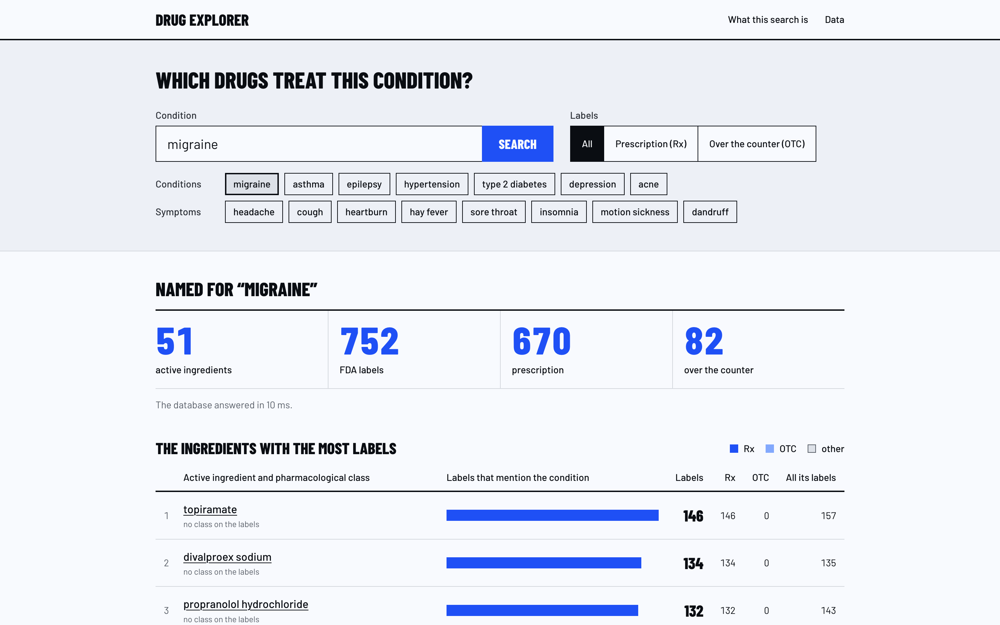
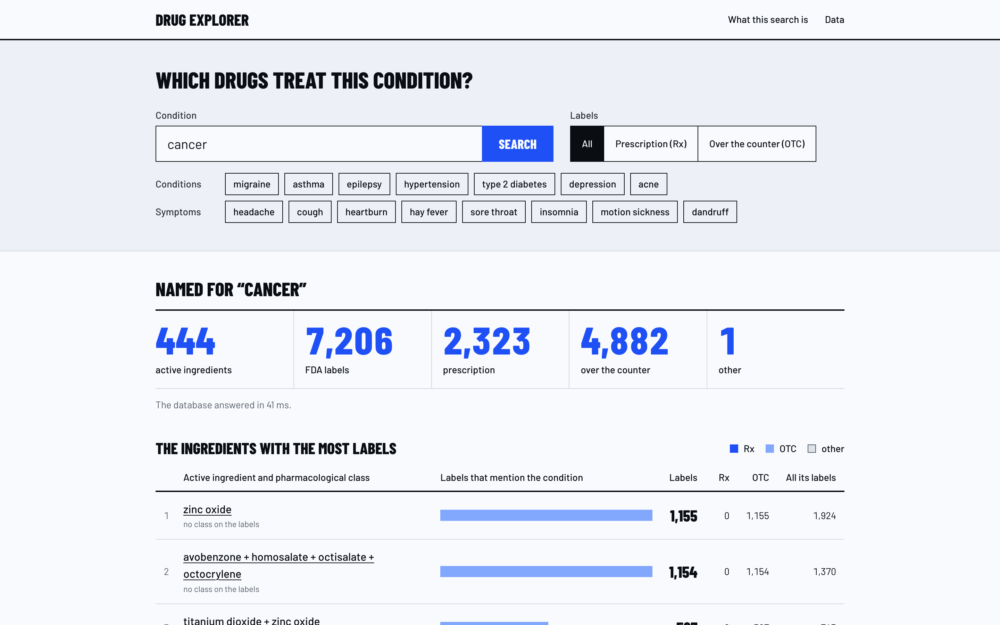

<!-- _class: title -->
<!-- _paginate: false -->
<!-- _footer: "" -->

Drug explorer

# Which drugs treat this condition?

Drug explorer. You type a condition, we list the active ingredients whose FDA label names it.

migraine<i></i>

SEARCH

<a class="repo" href="https://github.com/giulicastelli/drug-explorer/tree/main">Codegithub.com/giulicastelli/drug-explorer</a>

<b>Computing Infrastructures for Data Science, group D</b> Alessandro D'Amore, Andrea D'Ascanio, Federico Davolos, Giulia Castelli, Giovanni Margiacchi

<!--
0:45, Giulia.
Our question is one a friend understands: which drugs treat this condition?
You type a condition, for example migraine. The page lists the active ingredients whose FDA label names migraine in the section "Indications and usage".
It only reads the labels, so it is not medical advice. We show where it breaks during the demo.
-->

---

The data

# Every FDA drug label

1.87 GB14 zip files from openFDA

264,748labels in the export of 13 Nov 2026

84,381labels we keep

CC0public domain, no personal data

- The loader downloads the zips by script. No key, no login.
- We keep a label only if it has a standard ingredient name and an indications text. The others cannot answer the question.
- For the measurements we load 25%, 50% and 100% of the kept labels.

The FDA publishes a new export every week. The measurements use the export of 18 Nov (84,576 labels kept), and the live demo uses the one on the laptop.

<!--
1:30, Alessandro.
The data is the openFDA drug label export: the labels that companies file with the FDA. 14 zip files, 1.87 gigabytes.
The licence is CC0, so anyone can use it, and there is no personal data in it.
There are about 265 thousand labels. Two in three are of no use to us: they have no standard ingredient name, or no indications text. We keep 84,381.
We chose openFDA because it was the most comprehensive source, with the most data available, and that made the work simpler.
-->

---

Architecture

# Three containers, one command

<!--
1:30, Giulia.
docker compose up starts three containers, in order.
The database starts first. The loader waits until it is ready, downloads the zips, keeps the usable labels and loads them. Then it stops.
The page starts only after the loader has finished, so nobody sees a half-empty database.
The zips stay in a folder on the laptop and the database in a volume, so the second start is fast.
-->

---

The database

# Why PostgreSQL

Not MongoDB

- The raw labels are nested JSON. That points to MongoDB.
- But we keep 13 fields of each label, so every row has the same columns.
- The work is counting labels per ingredient. That is SQL.
- PostgreSQL has the word search the question needs.

One search is one query

1
PostgreSQL stores the stemmed words of each indications text: "migraines" becomes "migrain".

2
A GIN index says which labels contain a word.

3
The query finds the labels, counts them per ingredient and returns the top 25.

<!--
1:30, Andrea.
Which database? The raw data is JSON, and we first thought of MongoDB.
But after cleaning, every label has the same 13 fields, and the work is to group and count. That is what SQL does well.
PostgreSQL also has full-text search. It stores the words of each text in a reduced form and builds an index on them, like the index at the back of a book.
So one search is one SQL query.
-->

---

Live demo

# Demo: "migraine"

$ docker compose up # then localhost:8080

<a class="live" href="https://drug-explorer-xi.vercel.app">Livedrug-explorer-xi.vercel.app <b>→</b></a>

51ingredients

752labels

<ul class="tight">
<li>First: topiramate, 146 labels</li>
<li>Prescription or over the counter</li>
<li>Suggestions while you type</li>
<li>Select an ingredient to read what its labels say</li>
</ul>

<!--
3:00 for slides 5 and 6, Federico, live. This slide and the next are the backup if the laptop fails.
Show the terminal: docker compose up, the three containers, the loader that finishes.
Open localhost:8080. Type migraine.
51 active ingredients, in 752 labels. The first is topiramate, with 146 labels.
Switch to "over the counter": the list changes to the ones you can buy without a prescription.
Select topiramate: the page shows the sentence of each label that names migraine.
-->

---

The limit

# Where it breaks: "cancer"

The first results are sunscreens. Their labels say:

"decreases the risk of skin cancer"

The search finds the word. It does not know whether the drug <strong>treats</strong> the condition or <strong>prevents</strong> it.

!Do not use it as medical advice.

<!--
Still the demo. Type cancer.
The first results are zinc oxide and sunscreen filters. Not what you expect.
Their labels say "decreases the risk of skin cancer". The word is there, so the search finds them.
This is the limit of the project. We find a word in a text. We do not know whether the drug treats the condition or prevents it.
-->

---

<!-- _class: measure -->

Results

# Measurements

| | 25% | 50% | 100% |
|---|---|---|---|
| Labels loaded | 21,107 | 42,107 | 84,576 |
| Load, later start | 3.0 s | 5.0 s | 8.4 s |
| Load, first start | 35.9 s | 37.6 s | 41.2 s |
| `up` until the page answers, later start | 7.9 s | 10.0 s | 13.2 s |
| "migraine" query, with the index | 0.9 ms | 0.8 ms | 0.7 ms |
| "migraine" query, without the index | 8.2 ms | 19.4 ms | 33.8 ms |
| Peak memory: loader / db / app (MiB) | 200 / 61 / 41 | 218 / 76 / 41 | 283 / 121 / 41 |
| Database on disk | 44 MB | 78 MB | 147 MB |

MacBook Pro, Apple M2 Pro, 32 GB of RAM. Docker had 12 CPUs and 7.75 GiB. Mean of 3 runs, each on an empty database. The zips were already on disk. Runs of 18 Nov, on the export of that day.

<!--
1:00, Giovanni.
We measured at three sizes, three runs each, on one laptop, always from an empty database.
Time to load, time of a query, memory of each container, and the size on disk.
The next slide says what the numbers mean.
-->

---

Results

# What the numbers mean

2.8×<small>for 4× the labels</small>Loading grows more slowly than the data. With 4 times the labels it takes about 2.8 times as long.

33 s<small>to read the zips</small>The first start is as slow with a quarter of the data as with all of it. Reading the 14 zips takes about 33 s whatever we keep. That is why we save the kept rows in a CSV.

&lt; 1 ms<small>with the index</small>With the index a search takes under a millisecond at every size. Without it the time doubles when the data doubles, and at 100% it is about 49 times slower.

147 MB<small>on disk</small>It all fits on a normal laptop. The loader peaks at 283 MiB and the database is 147 MB, 7.9% of the zips.

<!--
2:00, Giovanni.
First: loading. Four times the data takes less than three times the time. Most of it is PostgreSQL storing the rows.
Second, the surprise. On the first start the time is almost the same at every size, because the loader has to read all the zips before it can keep a part. We come back to this in a moment.
Third: the index. With the index a search takes under a millisecond, whatever the size. Without it PostgreSQL reads every row, so the time grows with the data.
Fourth: it is small. Everything runs in a few hundred megabytes.
-->

---

# We built it twice

First version

549<small>lines of loader</small>
<ul>
<li>A Streamlit page and a loader of 549 lines.</li>
<li>It worked, and we measured it three times.</li>
<li>Going through it for today, we found wrong results, and code that not all of us could explain.</li>
</ul>

→

This version

238<small>lines of loader</small>
<ul>
<li>The search leaves out "not indicated" sentences.</li>
<li>The loader is 238 lines and does the same job.</li>
<li>The page is plain HTML on a small server, and it is online.</li>
</ul>

<!--
1:00, Alessandro.
We want to say this openly. What you see today is the second version.
The first one worked. It had a Streamlit page and a long loader, and we had measured it three times.
When we went through it for this presentation we found two problems. Some results were wrong, the next slide shows which. And the loader had grown so much that not all of us could explain every part.
So we changed our mind and rebuilt it in two days. Each of us redid the part they own, in a separate pull request.
The old measurements no longer describe the code, so we measured again. We kept the old ones in the repo.
-->

---

# What went wrong

Fixed<h3>A quarter of the data took as long as all of it</h3>The loader read all 14 zips and then threw away three labels in four. Now it saves the kept rows after the first read.
46.1 s → 13.2 s start at 100%

Fixed<h3>A good download was refused</h3>We compared each zip with the size in the FDA's file list, and that list is off by up to 0.16 MiB. Now the loader compares the bytes it receives with the size the server announces.

Fixed<h3>ADHD drugs came up under "psychosis"</h3>Their labels say "not intended for" children with psychosis. Now we cut from "not indicated" to the end of the sentence.
64 → 2 labels

Not fixed<h3>"Cancer" finds sunscreens</h3>We did not fix this one. A word search cannot tell "treats" from "prevents", so we say it on the page.

<!--
0:50 Alessandro (points 1 and 2), then 0:55 Andrea (points 3 and 4).
One. A quarter of the data took as long as all of it. The loader read every zip and threw away three labels in four. Now it saves the kept rows, and a start at 100% went from 46 to 13 seconds.
Two. The sizes in the FDA's file list are off by up to 0.16 MiB, so a good download was refused. We removed that check. Now the loader compares the bytes it receives with the size the server announces.
Three. ADHD drugs under "psychosis". A small SQL function cuts the "not indicated" sentences before indexing. 64 labels became 2.
Four. The sunscreens under "cancer". A word search cannot tell treating from preventing, so we say it on the page.
-->

---

<!-- _class: who -->

The team

# Who did what

| Who | Part |
|---|---|
| Alessandro D'Amore | Getting the data and loading it |
| Andrea D'Ascanio | The database: tables, index, queries |
| Federico Davolos | The page: processing and the final output |
| Giulia Castelli | Docker, the README, the diagram |
| Giovanni Margiacchi | Measurements |

<!--
1:00. Each of us says one sentence on their own part, in the order of the table.
Then questions.
-->

---

<!-- _class: title end -->
<!-- _paginate: false -->
<!-- _footer: "" -->

Drug explorer

# Thank you!

Questions?

<b>Computing Infrastructures for Data Science, group D</b> Alessandro D'Amore, Andrea D'Ascanio, Federico Davolos, Giulia Castelli, Giovanni Margiacchi

<!--
Giulia: "Thank you. We are happy to answer your questions."
-->
